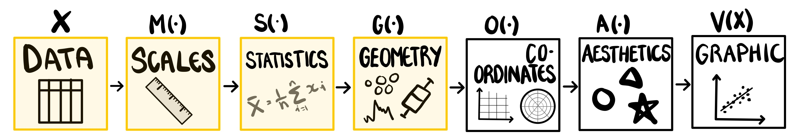

# A Mathematical Framework and Software Implementation for Uncertainty Visualisation {#sec-second-paper}


```{r}
#| label: setup
#| message: false
#| warning: false
#| echo: false

library(ggdibbler)
library(tidyverse)
library(distributional)
library(patchwork)
library(ggthemes)
library(ggdist)
# added for example plot at end
library(khroma)
library(tidygraph)
library(ggraph)
library(ozmaps)
library(sf)

# Theme adjustments
theme_set( theme_gdocs() + 
             theme(aspect.ratio = 1, 
                   axis.text.x = element_text(angle = 0, 
                                              vjust = 1.05, 
                                              hjust=1),
                   axis.line.y = element_line(colour = "black"),
                   palette.colour.continuous = gdocs_pal(),
                   palette.colour.discrete = gdocs_pal(),
                   )
)

```

## Introduction

> "Elegant design requires us to think about a theory of graphics, not charts." @Leland2005

Uncertainty visualisation has suffered from a serious lack of formalisation in recent years, which has resulted in an overwhelming tsunami of named plots.
No visualisation problem is too niche as we see various visualisations of 2D-intervals called a cross plot, rectangle plot, segment plot, and dandelion plot [@Zhang2022]. 
No plot change is too small with simulated outcomes on lines called spaghetti plots [@Allen2019], on maps called pixel maps [@Vizumap], and bar charts called fuzzygrams [@Kay2023]; and when these outcomes are animated, we call them hypothetical outcome plots (HOPs) [@Hullman2015].
No dead horse is too beaten with probability functions having more names than ways to differentiate them with terms like histogram, density plot, violin plot, ridgeline plot, rain plot, dot plot, and gradient plot, only scratching the surface [@Kay2023].
The practice of naming plots turns the field into a race, where authors are incentivised to brand their name on as many graphics as possible, rather than work towards a cohesive theory of visualisation.
This problem is as pervasive as it is frustrating.

According to @Leland2005, "the computer woefully focuses the mind", so we might assume that these hyper-specific naming conventions do not extend to the landscape of uncertainty visualisation software. 
This assumption would be wrong. 
Even just within the R ecosystem of `ggplot2` extensions, there is an overwhelming number of choices, leaving users unclear when each package should be used and for what purposes.
A density plot can be made using `ggplot2` [@ggplot2], `ggbeeswarm` [@ggbeeswarm], `ggridges` [@ggridges], `ggrain` [@ggrain], `ggdist` [@Kay2023], `ggpointdensity` [@ggpointdensity], and `ggdensity` [@ggdensity], all packages with similar descriptions and overlapping designs.
This is not to say these packages are pointless: they have thousands of downloads per week and are often motivated by a genuine gap in the software ecosystem. 
Rather, we want to illustrate the havoc that named plots wreak. 

With this wealth of choices in plots and software, it would be reasonable to assume that the field is meeting the needs of its users, albeit in a messy, roundabout way.
This assumption would be incorrect. 
Despite this wealth of choice, each package is brittle and constrained by its own set of assumptions.
There is a cry for flexibility among the users of uncertainty visualisation software, dating back more than 30 years [@MacEachren1992].
A useful uncertainty visualisation system should allow for exploration with uncertain data from multiple different sources, dimensions, and data types [@Hadjimichael2024; @geointerviews; @MacEachren2005], a flexibility that all current implementations fail to provide. 
This implies the real gap in uncertainty visualisation is not new plots or bespoke software, but structure, and the flexibility that comes with it. 

Structure is not so alien to the visualisation community that this is an unreasonable request.
Standard statistical graphics have been formalised within **the grammar of graphics** [@Leland2005; @ggplot2] for several decades.
This structure has largely been ignored by the uncertainty visualisation community, with the exception of @Kay2023.
Kay formalised the visualisation of univariate probability functions in the `ggdist` R package, with the acknowledgement that this formalisation is not whole, as it doesn't include designs such as the HOP and spaghetti plot.
The missing half of this framework, and its implementation in the `ggdibbler` package, is what will be discussed in the rest of this paper. 

## A motivating example {#sec-example}
Uncertainty visualisation fundamentally boils down to a problem where some (or all) of the cells in our data set are random variables rather than deterministic observation.
However, once we have these distribution inputs, what exactly should should our visualisation system *do* with these distributions?

@fig-dist-example investigates this question, specifically for the scenario where we are trying to make a density plot. 
Lets start with the case where we have no uncertainty at all.
Say we have a vector that contains the height of 15 different people, $\textbf{x}$, where each element of the vector $x_i \in \textbf{x}$ represents one measured height.
If we feed this vector into a density plot function, such as `geom_density()` from `ggplot2`, we get an estimated density curve of our data that is displayed using a line geometry, as shown in the in @fig-dist-example (a).
This is a straightforward example, but what happens when our input is a distribution? 
This is quite a common scenario in statistics.
We frequently have observations with measurement error, output from inferential procedures, or anonymised data that has been imbued with noise.
These observations are more accurately represented by distributional, rather than deterministic, units. 
In the case of our example, lets say the height measurements, $\textbf{x}$, were calculated using a tool with a known measurement error that changes depending on the environmental conditions.
This error was ignored in @fig-dist-example (a).
Now we have a random vector, $\tilde{\textbf{x}}$, of 15 distributions, $\tilde{x_i} \sim N(x_i, \sigma_i), \ \forall i=1,...,15$, where $x_i \in \textbf{x}$ is the recorded value used in our deterministic visualisation, and $\sigma_i$ is the measurement error. 
There are two routes we can take when it comes to visualising this estimate. 
The first route involves looking at the distribution of each individual measurement (as we would make using `ggdist`) and is shown in plot @fig-dist-example (b). 
The second route involves visualising the full data density while carrying forward the variability that comes with having distributional inputs (as we would make using `ggdibbler`) and is shown in plot @fig-dist-example (c). 

```{r}
#| label: fig-dist-example
#| fig-cap: "Alternative interpretations of how to render a density plot when the input is a set of distributions, according to three plotting packages: (a) `ggplot2` shows the density of the full data set using the mean values, (b) `ggdist` shows the distribution of each observation, (c) `ggdibbler` shows shows the density of the full data set but but uses resampling to carry through the uncertainty in each observation. These differences illustrate how uncertainty is interpreted in different ways. Which is correct?"
#| fig-height: 4
#| fig-width: 12
#| out-width: 90%
#| fig-pos: "t"
#| dev: "png"
#| echo: false
set.seed(1)
density_data <- data.frame(xmean = rnorm(15, 163, 7),
                           xse = rexp(15,0.5)) |>
  mutate(xdist = distributional::dist_normal(xmean, xse))
tsize = 12

d1 <- ggplot(data = density_data) +
  geom_density(aes(x = xmean), linewidth=1) +
  xlab("Height") +
  ggtitle("a. ggplot2") +
  theme(plot.title = element_text(size = tsize))

d2 <- ggplot(data = density_data) +
  stat_slab(aes(xdist = xdist), colour = "black", fill=NA,
            linewidth = 0.5) +
  xlab("Height") + ylab("density") +
  ggtitle("b. ggdist") +
  theme(plot.title = element_text(size = tsize))

d3 <- ggplot(data = density_data) + 
  geom_density_sample(aes(x=xdist), times=100, 
                      linewidth=0.1) +
  scale_linewidth(range = c(0.1, 0.1)) +
  xlab("Height") +
  ggtitle("c. ggdibbler") +
  theme(plot.title = element_text(size = tsize))

d1 + d2 + d3
```

The distinction between the two approaches presented in @fig-dist-example is the same signal and noise paradigm presented by @Mason2026. 
In the `ggdist` plot, we are interested in the shape of the distribution of each observation, so we are visualising the uncertainty as a signal.
In the `ggdibbler` plot, we are not interested in the uncertainty in and of itself, but rather, we only included it to see how it would change the conclusions from the  `ggplot2` plot, thus, visualising it as noise. 

Often, the "correct" visualisation depends on the goals of our analysis and what we are looking to infer from the plot.
However, visualisations are often made in the context where we don't know what we want to infer, that is, they are often used for EDA.
An uncertainty visualisation system that is suitable for EDA should allow us to visualise uncertain data just as freely as we currently visualise deterministic data. 
This means that every *existing* plot made using deterministic data should have an uncertain counterpart. 
Therefore we can boil our uncertainty visualisation problem, illustrated by @fig-dist-example, down into the question: "Which plot is the correct behaviour of `geom_density` with the distributional input, $\tilde{\textbf{x}}$?".
The answer to this question is definitively, the `ggdibbler` plot. 
The reasoning is rooted in strong statistical foundations; we just need to expand the concepts to visual statistics.

## Visual Statistics
### The deterministic visual function
When you really think about it, what is a visualisation?
One of the most definitive answers to this question can be found in the grammar of graphics, which is a theoretical framework that characterises a visualisation as a series of composite functions [@Leland2005]. 
Under this formalisation, a visualisation is a function that takes a deterministic matrix (@def-deterministic) as input and outputs a statistical graphic. 
This formalisation is lengthy, so we summarise the key aspects of it in  @def-vfunc, and @fig-gog, which shows each step of the visualisation process with highlighted components indicating the sections we will need to adjust for uncertainty visualisation. 
These steps summarise the underlying architecture of the `ggplot2` [@ggplot2] implementation of the grammar, which is an essential foundation for our new software, `ggdibbler`. 
However, the conceptual framework described here is not dependent on any particular implementation of the grammar and could easily be implemented in another grammar of graphics system, such as Vega-Lite [@Satyanarayan2016].
The notation used for visual statistics builds on that developed in @Majumder2013 where the term was first introduced in the context of conducting statistical inference.

::: {#def-deterministic}
## Deterministic matrix
Let $\textbf{A}$ be an $m \times n$ matrix on the sample space $\Omega$. $\textbf{A}$ is a deterministic matrix if $a_{i,j} \ \forall \ 1 \leq i \leq n, 1 \leq j \leq m$ are single-value (non-random) entries.
:::


::: {#def-vfunc}
## The deterministic visual function
Let $\textbf{X}$ be an $m \times n$ deterministic matrix on the sample space $\Omega$. Let $V$ be a function that maps $\textbf{X}$ from our sample space $\Omega$ to the space of all visual statistics, $\Psi$. We refer to $V$ as a visual function, and the output $V(X)$ as a visual statistic. The visual function, $V$, can be decomposed into the following composite function: 

$$
V = A \circ O \circ G \circ S \circ M
$$ 
where:
  
- $M: \Omega \xrightarrow{} \mathbb{R}$ is the scale function, $M = [M_1, M_2, ..., M_{m}]'$, that maps each column of the $\textbf{X}_{n,m}$ matrix to the real number line, $\mathbb{R}$.
- $S: \mathbb{R} \xrightarrow{} \mathbb{R}$ is the statistic function that calculates a statistical summary of the data. This function has few limitations, and it can change the number of rows and columns of the matrix, resulting in a $\textbf{X}_{n*,m*}$ matrix.
- $G: \mathbb{R}^2 \xrightarrow{} B^2$ is the geometry function that operates on the position columns of $\textbf{X}_{n*,m*}$. The function converts real numbers to representations of magnitudes in space on the bounded plane, $B^2$ (for a 2D graph), where $B^2 \subset \mathbb{R}^2$. We can further decompose $G$ into $G = E\circ P$, where $E: R^2 \xrightarrow{} B^2$ handles the mapping to the bounded plan, and $P: B^2 \xrightarrow{} B^2$ is the position modifier that ensures observations do not overlap.
- $O: B^2 \xrightarrow{} B^2$ sets the coordinate system for bounded plane.
- $A: R \xrightarrow{} \mathbb{R}$ is an injective function that transforms our full $\textbf{X}_{n*,m*}$ matrix into physically observable stimuli. The function maps our data from $\mathbb{R}$ to the space of visual statistics $\Psi$.

:::


{#fig-gog fig-pos="t"}

### Random matrices and continuous mapping theorem
Unlike a standard visualisation, an uncertainty visualisation has a random matrix (@def-random) input, where distributions replace the single values of our deterministic matrix (@def-deterministic).

::: {#def-random}
## Random matrix
Let $\tilde{\textbf{A}}$ be an $m \times n$ matrix-valued random variable on the probability space $(\Omega, \mathcal{F}, Pr)$. This is a matrix where some or all of its entries are random variables drawn from some probability distribution.
:::


Combined, @def-random and @def-vfunc boil uncertainty visualisation down to a simple problem.
Our visualisation system needs to be designed in such a way that it follows existing mathematical principles of random variables and functions.
More specifically, our graphics should uphold the *continuous mapping theorem* [@mann_wald], @thm-cmt. 

::: {#thm-cmt}

## Continuous mapping theorem
Let $\tilde{\textbf{X}}$ and $\tilde{\textbf{Y}}$ be $n \times m$ random matrices, and let $\textbf{Z}$ be an $n \times m$ deterministic matrix. Let $f: Q \xrightarrow{} Q'$ be a continuous function from one metric space, $Q$, to another $Q'$. Then:
$$\tilde{\textbf{X}} \xrightarrow{} \tilde{\textbf{Y}} \Rightarrow f(\tilde{\textbf{X}}) \xrightarrow{} f(\tilde{\textbf{Y}})$$

and

$$\tilde{\textbf{X}} \xrightarrow{} \textbf{Z} \Rightarrow f(\tilde{\textbf{X}}) \xrightarrow{} f(\textbf{Z})$$
:::

In simple terms, @def-vfunc and @thm-cmt mean that our uncertainty visualisations should have similar convergence properties to their underlying distributions.

If we accept the idea that a visualisation is a continuous function, adhering to @thm-cmt is not a nice property or an opinion on how visualisations should behave, but rather a *fundamental requirement* of any visualisation of a random matrix.
Or, at least it will be after we establish that the assumptions of @thm-cmt are true.
This will require us to show that $\Omega$ and $\Psi$ are metric spaces, and then use those metric spaces to define convergence for visual functions.

#### Visual metric spaces
The idea that both $\Omega$ and $\Psi$ are metric spaces is not particularly strange.
One of the core tenets of statistical graphics is that they maintain the link between data and visual aesthetic [@Leland2005].
It is also the primary property that differentiates them from drawings [@Bartonicek2025].
This notion of maintaining structure from $\Omega$ to $\Psi$ implies there is some kind of implicit ordering, or metric that can be applied to both spaces. 
Unfortunately, the allusion to structure is not structure, and determining a suitable metric requires weighing up multiple, sometimes competing, criteria [@Dubey2024].
Here we will attempt to define a more concrete metric for statistical graphics.

Of the two spaces, $\Omega$ has a more intuitive notion of distance.
In most cases, $\Omega \subseteq \mathbb{R}$ so we can use Euclidean distance, $d$, as a metric leading to the metric space ($\Omega$, $d$).
In the cases where $\Omega \not\subseteq \mathbb{R}$, the first step of the visual function, $V$, is to scale the data to $\mathbb{R}^p$ using $M$, so, we can use $d \circ M$ as our metric.
In either case, we can say that ($\Omega$, $d \circ M$) is a metric space.

The metric for $\Psi$, is a little more difficult to define.
When selecting a metric, some of the criteria we might consider include ease of implementation and existing notions of similarity [@Dubey2024].
Given that visualisations are designed to be viewed by humans, a natural notion of "distance" would be the human ability to visually differentiate two plots, which we will refer to as $h$.
This is similar to the notion of distance that is leveraged by the lineup protocol [@Buja2009], the statistical graphic equivalent of a hypothesis test. 
In the lineup protocol, viewers are shown $M$ plots consisting of $M-1$ null plots, $V(\textbf{X}_{N_i})$, where $\textbf{X}_{N_i}$ for $i=1, ..., M-1$ are independent draws generated from some null distribution, and a visual test statistic, $V(\textbf{X}_T)$, where $\textbf{X}_T$ is our actual data. 
If the test statistic, $V(\textbf{X}_T)$, is significantly different, visually, from $V(\textbf{X}_{N_i}) \ \forall i$, then viewers will be able to pick it out of the lineup, and we would reject the null hypothesis that $\textbf{X}_T$ was generated from the same distribution as $\textbf{X}_{N_i}$.
Therefore, using our metric of visual distinguishability, we can consider the lineup protocol a measure of Mahalanobis distance on ($\Psi$, $h$).
This interpretation of $h$ implies the metric should behave like an inverse of the aesthetic function, $A^{-1}$, utilising the power of the human visual system to estimate the Euclidean distances in the original data.
This sentiment is also conveyed by the wealth of value extraction studies in psychophysics research that rank aesthetic mappings on how closely their human perception maps to $A^{-1}$ [@Cleveland1984; @Vanderplas2020].
Therefore, we can consider $h$ to be a continuous (albeit often warped) approximation of the metric, $g = d \circ A^{-1}$.

Unfortunately, despite human perception being the natural metric for statistical graphics, ($\Psi$, $h$) it is not a metric space.
Human perception has several quirks, one of which is "just noticeable differences" (JND) [@Luce1958], which stops us from differentiating marginally different stimuli.
These JND, can be used to show our metric $h$ violates the triangle inequality, which we illustrate this with a quick proof in @sec-appendix-a.
While preventing our aesthetic function, $A$, from mapping to increments less than the JND would prevent $h$ from violating the triangle inequality, the solution is not feasible in practice as the threshold for JND are not consistent across the entire population.
This is to say nothing of the issues that might arise from the other numerous oddities in human perception.
Given these difficulties, we will use the metric space ($\Psi$, $d \circ A^{-1}$), with the understanding that our perceptual function, $h$ is an approximation of this distance.

#### Visual convergence
Now that we have defined the metric spaces we are working in, we can define the concept of convergence for visual functions.
Thankfully, this is also covered by our definition of a metric space.
Two plots have converged if their renderings are identical.

::: {#def-converge}

## Visual convergence
Let $\tilde{\textbf{X}}$ and $\tilde{\textbf{Y}}$, be $n \times m$ random matrices, and let $\textbf{Z}$ be an $n \times m$ deterministic matrix. Let $V$ be a visual function $V$: $\Omega\xrightarrow{} \Psi$. Let $g$: $\Psi\xrightarrow{} \mathbb{R}$ where $g = d \circ A^{-1}$, and $(\Psi, g)$ is a metric space. We say two random graphics have visually converged, that is, $V(\tilde{\textbf{X}}) \xrightarrow{} V(\tilde{\textbf{Y}})$ when $g(V(\tilde{\textbf{X}}), V(\tilde{\textbf{Y}})) = 0$. We say that a random graphic has converged to a deterministic graphic, that is, $V(\tilde{\textbf{X}}) \xrightarrow{} V(\textbf{Z})$ when $g(V(\tilde{\textbf{X}}), V(\textbf{Z})) = 0$.
:::


### Returning to the density plot example
In @sec-example, asked what a density plot should do with a random matrix input.
In doing so, we defined a vector of heights, $\textbf{x}$ and $\tilde{\textbf{x}}$ such that $\tilde{x}_i \xrightarrow{p} x_i$ as $var(\tilde{x}_i) \xrightarrow{} 0, \forall \ i = 1,...,15$. 
According to our definition of the visual function, we should therefore also see $V(\tilde{\textbf{x}})\xrightarrow{p}V(\textbf{x})$. 
That is, as the measurement error in $\tilde{\textbf{x}}$ approaches zero, our uncertainty visualisation should be visually indistinguishable from the `ggplot2` plot in @fig-dist-example.
The convergent behaviour of the `ggdibbler` and `ggdist` plots from @fig-dist-example, as the variance approaches zero, are shown in @fig-dist-converge.
The figure show the `ggdibbler` plot converging to the `ggplot2` visualisation of `geom_density`, while the `ggdist` plot converges to a `geom_rug`.
Therefore, the `ggdibbler` plot is the random matrix version of the `geom_density` function from `ggplot2`.

```{r}
#| label: fig-dist-converge
#| fig-cap: "A series of graphics that display the behaviour of our density plots as the variance drops to zero. The top row shows the ggdibbler plots, while the bottom row shows the ggdist plots with decreasing variance from left to right. We can see that the ggdibbler plot is converging to the ggplot2 density plot, while the ggdist plot density will converge to a rug plot."
#| fig-height: 7
#| fig-width: 12
#| out-width: 100%
#| fig-pos: "t"
#| dev: "png"
#| echo: false
set.seed(1)
density_data <- data.frame(xmean = rnorm(15, 163, 7),
                           xse1 = rexp(15,0.5)) |>
  mutate(xse2 = 0.3*xse1, 
         xse3 = 0.05*xse1)
tsize = 12

p1 <- ggplot(data = density_data) + 
  geom_density_sample(aes(x=dist_normal(xmean, xse1)), times=100, 
                      linewidth=0.1) +
  scale_linewidth(range = c(0.1, 0.1)) +
  xlab("Height") +
  theme(plot.title = element_text(size = tsize))

p2 <- ggplot(data = density_data) + 
  geom_density_sample(aes(x=dist_normal(xmean, xse2)), times=100, 
                      linewidth=0.1) +
  scale_linewidth(range = c(0.1, 0.1)) +
  xlab("Height") +
  theme(plot.title = element_text(size = tsize))

p3 <- ggplot(data = density_data) + 
  geom_density_sample(aes(x=dist_normal(xmean, xse3)), times=100, 
                      linewidth=0.1) +
  scale_linewidth(range = c(0.1, 0.1)) +
  xlab("Height") +
  theme(plot.title = element_text(size = tsize))

p4 <- ggplot(data = density_data) + 
  geom_density_sample(aes(x=dist_normal(xmean, 0))) +
  scale_linewidth(range = c(0.1, 0.1)) +
  xlab("Height") +
  theme(plot.title = element_text(size = tsize))


q1 <- ggplot(data = density_data) +
  stat_slab(aes(xdist = dist_normal(xmean, xse1)), 
            colour = "black", fill=NA,
            linewidth = 0.5) +
  xlab("Height") + ylab("density") +
  theme(plot.title = element_text(size = tsize))

q2 <- ggplot(data = density_data) +
  stat_slab(aes(xdist = dist_normal(xmean, xse2)), 
            colour = "black", fill=NA,
            linewidth = 0.5) +
  xlab("Height") + ylab("density") +
  theme(plot.title = element_text(size = tsize))

q3 <- ggplot(data = density_data) +
  stat_slab(aes(xdist = dist_normal(xmean, xse3)), 
            colour = "black", fill=NA,
            linewidth = 0.5) +
  xlab("Height") + ylab("density") +
  theme(plot.title = element_text(size = tsize))

q4 <- ggplot(data = density_data) +
  stat_slab(aes(xdist = dist_normal(xmean, 0)), 
            colour = "black", fill=NA,
            linewidth = 0.5) +
  xlab("Height") + ylab("density") +
  theme(plot.title = element_text(size = tsize))

pv <- ggplot() +
  geom_segment(aes(x = 0, xend = 5, y = 1 ), arrow = arrow()) +
  geom_text(aes(label = expression(sigma), x = -0.2, y = 1 ), size = 10) +
  geom_text(aes(label = "0", x = 5.2, y = 1 ), size = 10) +
  geom_text(aes(label = "as the variance approaches zero", x = 2.5, y = 1.1 ), size = 6) +
  ylim(0.5,1.5) +
  theme_void()


pv / (p1 | p2 | p3 | p4 ) / (q1 | q2 | q3 | q4)

```

## Generalising the visual function
The visual function, as described by @def-vfunc, has one key limitation; it assumes each data point is deterministic.
This is an issue for uncertainty visualisation, as a random matrix input is one of the core assumptions of the approach.
To redefine our visual function such that it accepts random matrix inputs and obeys @thm-cmt, we will need to adjust the definition of our **scale**, **statistic**, and **geometry**.
When we finish, we should have a generalised version of the visual function that accepts random matrix inputs. 


### The adjustment to `scales`
Scales map our data to a set of real number outcomes; they determine how we perceive the size, shape, and location of our data, and give our data meaning [@Leland2005].
This sentiment is echoed in the construction of our visual statistics, as the scale $M$ is used to define the distance metric for our data.
As the scale gives our data meaning, do not want to change it when we swap our deterministic matrix, $\textbf{X}$, for a random one, $\tilde{\textbf{X}}$.
This requires a *change of variable*, which gives us a "scale aware" uncertainty visualisation system, as described by @Kay2023.
This formalisation of this scale is summarised in  @def-scale, and illustrated in @fig-scale.

::: {#def-scale}
## Generalised scale
Let $\Omega$ be a sample space and $M$: $\Omega\xrightarrow{} \mathbb{R}$ be a scale function that maps our data from $\Omega$ to $\mathbb{R}$. 
Let $\tilde{\textbf{X}}$ be a random matrix on the probability space $(\Omega, \mathcal{F}, P)$.
Then the generalised scale function $M^*$, applied to $\tilde{\textbf{X}}$ will give us $M^*(\tilde{\textbf{X}})$ with the induced probability measure $P_{M^*}(A) = P({M^*}^{-1}(A))$. 
:::

{#fig-scale width=80%}


### The adjustment to `statistics`
Statistics provide a summary of our data. 
Several graphics, such as a box plots (via the five-number summary) and bar chart (via summation) are defined by this component.
Summarising our data into these neat statistical summaries is currently handled by the  statistic function, $S$.
Many statistics are not well defined for random variables, so we need to decide how we are going to represent our random variables before computing statistics on them.
Therefore, our statistic function in uncertainty visualisation has two roles: the first is to extract the statistic we use to represent our random variable, and the second is to summarise the data (if required).
The generalised statistic function is shown in @def-stat.

::: {#def-stat}

## Generalised statistic
Let $\tilde{\textbf{X}}$ be an $n \times m$ random matrix on the probability space $(\mathbb{R}, \mathcal{F}, P)$.
Let $S_{sample}: (\mathbb{R}, \mathcal{F}, P)\xrightarrow{} \mathbb{R}$ be a function that transforms the random matrix $\tilde{\textbf{X}}$ into the deterministic $\textbf{Z}$ $n \times m \times t$ array, where $t$ is the number of samples drawn from $\tilde{\textbf{X}}$.
Let $S$: $\mathbb{R}\xrightarrow{} \mathbb{R}$ be a function that transforms the deterministic matrix, $\textbf{Z}$ into a statistical summary, $\textbf{Y}$, an $n^* \times m^* \times t$ array.
Note that $S$ covers all statistics that can be implemented in the deterministic grammar of graphics.
We define $S^*: (\mathbb{R}, \mathcal{F}, P)\xrightarrow{} \mathbb{R}$ to be the composite function $S^* = S_{sample} \circ S$ that transforms the random matrix $\tilde{\textbf{X}}$ into the deterministic array, $\textbf{Y}$.

:::

The definition presented in @def-stat may leave you with some questions, specifically, why we have limited the distribution representation to a sample of outcomes. 
This is the question we will spend the rest of this section answering.

#### Representing a distribution
Distributions are abstract concepts, and visualising them requires us to choose a concrete representation.
There is substantial flexibility in the way distributions are represented in the literature, as we frequently see uncertainty displayed as a sample of outcomes, a mean and variance, a confidence interval, or even several of these statistics at once [@Potter2010; @Kay2023]. 
When selecting the representations, authors rarely discuss how these choices might affect the goals of uncertainty visualisation, or the other components of the plot.
Unfortunately, allowing complete freedom in the distribution can lead to visualisations that ignore uncertainty, a system that lacks flexibility, or a system that can only handle one random variable at a time.
In addition to these issues, complete freedom can also lead to violations to @thm-cmt. 

#### Why not point estimates?
Allowing complete freedom in the way we represent our distribution leads to visualisations that ignore uncertainty entirely.
This issue is illustrated by @fig-meanprob, which shows a set of bivariate densities as raster plots.
This figure visualises the `uncertain_faithfuld` data from `ggdibbler`, which is a random matrix variation of the `faithfuld` data from the `ggplot2` package.
Plots (a) and (b) use the mean of each distribution, while plots (c) and (d) use a sample. 
This variance is independent of our expected value, so the increasing variance has no impact on the mean of the distribution.
This means the visualisation using our point estimate does not change as the variance increases, and the plot is always equivalent to displaying a variance of zero.
On the contrary, the visualisation that uses a sample shows the "graininess" of the plot increasing with the uncertainty.
As the variance increases, these grains dominate the plot, making the visualisation harder to read, as we would expect.

```{r}
#| label: fig-meanprob
#| fig-cap: "How uncertainty is handled (or not) in raster displays of bivariate density.  The axes show the eruption time vs waiting time, and colour indicates density value, with lighter colours indicating higher density. In plot (a) and (b) uncertainty is ignored by showing only the estimate, while (c) and (d) show samples. We can see that as the variance in the estimates increases, the visualisation of the sample becomes harder to read and conveys more uncertainty, while the visualisation of the mean remains unchanged."
#| fig-height: 3
#| fig-width: 10
#| out-width: 100%
#| fig-pos: "t"
#| echo: false
library(colorspace)
p1a <- ggplot(uncertain_faithfuld, aes(x = waiting, 
                                      y = eruptions, 
                                      fill = mean(density0)))+
  geom_raster() +
  ggtitle("a. mean - low error") +
  scale_fill_continuous_sequential(palette = "Terrain", rev = FALSE) +
  theme(legend.position = "none", legend.direction = "horizontal",
        plot.title = element_text(size = tsize)) +
  labs(fill = "density")


p1b <- ggplot(faithfuld |> mutate(density = dist_normal(density, 0.005)), aes(waiting, eruptions, fill = density)) +
  geom_raster_sample()+
  ggtitle("c. sample - low error") +
  scale_fill_continuous_sequential(palette = "Terrain", rev = FALSE)+
  theme(legend.position = "none", legend.direction = "horizontal",
        plot.title = element_text(size = tsize))

p2a <- p1a +
  ggtitle("b. mean - high error") 

p2b <- ggplot(faithfuld |> mutate(density = dist_normal(density, 0.02)), aes(waiting, eruptions, fill = density))  +
  geom_raster_sample() +
  ggtitle("d. sample - high error") +
  scale_fill_continuous_sequential(palette = "Terrain", rev = FALSE)+
  theme(legend.position = "none", legend.direction = "horizontal",
        plot.title = element_text(size = tsize))


p1a + p2a + p1b + p2b + plot_layout(ncol=4)

```

You may still want to visualise summary statistics alongside our uncertainty representation.
This is a common sentiment, and it is the same desire that causes us to visualise a mean and confidence interval on the same plot.
Unfortunately, there is a reasonable amount of evidence that visualising summary statistics alongside uncertainty information causes that uncertainty information to be ignored [@uncertchap2022].
Allowing you to include the point estimates that allow you to ignore the noise, explicitly because the visualisation is too noisy, defeats the entire purpose of the approach.

#### Why not probability density functions?
Disallowing point estimates doesn’t actually limit our flexibility, as we still have samples, quantiles, and probability functions at our disposal.
However, all representations do not maintain the flexibility of *the grammar of graphics* and therefore prohibit our system from being used for EDA.
The orthogonality of *the grammar of graphics* is what provides its flexibility, as it allows us to indiscriminately swap elements of our plot, such as the statistic or geometry.
If we want to maintain this flexibility, the uncertainty visualisation version of a graphic should not interfere with this orthogonality.
This property does not hold when we allow distributions to be represented as probability density functions (PDFs).

Allowing complete freedom in distribution representation can create a mismatch where the values we are trying to feed into our statistic, $S$, are on the domain that is expected by the function.
To be more explicit, our statistic, $S$ is expecting values on the domain, $M(\Omega)$.
So, when we define a new statistic, $S^* = S \circ S_{dist}$, as $S$ is applied straight after $S_{dist}$, the range of $S_{dist}$ needs to be the same as $M(\Omega)$ or our function $S^*$ will be ill-defined.
For example, if our statistic is expecting heights that range from 150 to 200, we cannot feed in a set of probabilities on [0,1] and expect the computation to remain coherent.
For these reasons, we can only allow statistical representations that have a range that is equivalent to the input space, which would disallow PDFs.

#### Why not quantiles?
Losing point predictions and density functions as viable representations still leaves quantiles and samples as potential distribution representations.
It makes sense that these methods would be the most flexible, as a sample is just outcomes on $M(\Omega)$, and quantiles are just ordered samples.
However, when we try and use quantiles in practice, we quickly run into problems as they require an explicit ordering on $\Omega$.
This ordering doesn't exist when we have categorical data or multiple uncertain variables.

Uncertain categorical variables are typically unordered.
Examples of this type of data include predictions from a classification model.
While our data is technically ordered at this stage of the visualisation process - due to the scaling of $M(\Omega)$ - the quantiles, and by extension any visualisation of those quantiles, will be inherently meaningless due to the lack of order in $\Omega$.

Uncertain multivariate data present another scenario where our quantiles lost their meaning.
Examples of this type of data include the estimated intercept and slope for a linear regression.
Unlike univariate data, multivariate data has no inherent ordering, so quantiles - such as marginal or equicoordinate quantiles - must impose their own notion of distance [@Bornkamp2018].
@fig-circle-line visualises the four scenarios that arise from passing a random variable to the slope and intercept, represented as a quantile or a
sample, to a `geom_abline`.
In all four plots, the lines are coloured according to their empirical marginal quantile.
Plots (a) and (b) show the one dimensional case, were the slope is deterministic, $\Delta = 1$, and the intercept is random with a $N(0,1)$ distribution.
We can see that in this univariate case, both the visualisation using quantiles (a) and the sample (b) have a smooth colour gradient, as quantiles do not impose any unwarranted structure on the visualisation.
Plots (c) and (d) show the two dimensional case, where the slope and intercept have a joint normal distribution with marginal distributions $N(0,1)$ and a covariance of $-0.8$.
We can see that in this multivariate case, the colour gradient in the quantile (c) plot remains smooth but the colour in the sample (d) plot is far more erratic.
The ordering imposed by the quantiles not only creates an artificial neatness, but also changes the visual features, such as the point of intersection of the lines.
In plot (c) the intersection of the lines sits around $x=-1$, but in plot (d), the lines intersect as $x=1$.
Even if we tried to work around these problems by coming up with some abstract definition of a visual quantile, such as the mass of pixels, the final result could not be constructed with a straight line, which is the only real requirement for `geom_abline`.

```{r}
#| label: fig-circle-line
#| fig-cap: "This figure shows the distribution of a line with either one or two random variable inputs, represented as either a quantile or a sample. The plots show a line with (a) a random intercept and constant slope using quantiles; (b) a random intercept and constant slope using a sample; (c) a random intercept and random slope using quantiles; and (d) a random intercept and random slope using a sample. All four plots colour the points using the same distance calculation, which is equivalent to colouring by the marginal quantile. The direct translation of colour to quantiles can be seen in the smooth colour gradient of the visualisation in plots (a), (b) and (c). The colouring of the sample becomes erratic in plot (d), as there is no natural ordering for a point cloud, and the distance imposed by the quantiles becomes somewhat arbitrary."
#| fig-height: 3
#| fig-width: 10
#| out-width: 100%
#| dev: "png"
#| echo: false


# Random intercept

# Generate multivariate data
set.seed(112)
dist <- dist_multivariate_normal(mu = list(c(0,0)), 
                                 #sigma = list(matrix(c(1,0,0,1), ncol=2)))
                                 sigma = list(matrix(c(1,-0.8,-0.8,1), ncol=2)))
dimnames(dist) <- c("x", "y")

a <- quantile(dist, p = seq(0, 1, length.out = 100),
              type = "marginal") 
qdf <- tibble(x = unlist(a)[1:100],
              y = unlist(a)[101:200]) |>
  rownames_to_column() |>
  mutate(rowname = as.numeric(rowname)) 

b <- generate(dist, times = 100)
sdf <- tibble(x = unlist(b)[1:100],
              y = unlist(b)[101:200]) |>
  rownames_to_column() |>
  mutate(rowname = as.numeric(rowname),
         distance = sqrt(x^2 + y^2),
         rawdist = x + y)


q1 <- qdf |>
  ggplot() + 
  geom_abline(aes(intercept = x, slope = 1, colour = x), 
              alpha=0.7, linewidth=1.5) +
  scale_colour_continuous_sequential(palette = "Batlow") +
  scale_x_continuous_distribution(limits = c(-2,2)) +
  scale_y_continuous_distribution(limits = c(-2,2)) +
  ggtitle("a. quantile: intercept") +
  theme(legend.position="none", plot.title = element_text(size = tsize))

q2 <- sdf |>
  ggplot() + 
  geom_abline(aes(intercept = x, slope = 1, colour = x), 
              alpha=0.5, linewidth=1.5) +
  scale_colour_continuous_sequential(palette = "Batlow") +
  scale_x_continuous_distribution(limits = c(-2,2)) +
  scale_y_continuous_distribution(limits = c(-2,2)) +
  ggtitle("b. sample: intercept") +
  theme(legend.position="none", plot.title = element_text(size = tsize))

q3 <- qdf |>
  ggplot() + 
  geom_abline(aes(intercept = x, slope = y, colour = rowname), 
              alpha=0.7, linewidth=1.5) +
  scale_colour_continuous_sequential(palette = "Batlow") +
  scale_x_continuous_distribution(limits = c(-2,2)) +
  scale_y_continuous_distribution(limits = c(-2,2)) +
  ggtitle("c. quantile: intercept, slope") +
  theme(legend.position="none", plot.title = element_text(size = tsize))

q4 <- sdf |>
  ggplot() + 
  geom_abline(aes(intercept = x, slope = y, colour = rawdist), 
              alpha=0.5, linewidth=1.5) +
  scale_colour_continuous_sequential(palette = "Batlow") +
  scale_x_continuous_distribution(limits = c(-2,2)) +
  scale_y_continuous_distribution(limits = c(-2,2)) +
  ggtitle("d. sample: intercept, slope") +
  theme(legend.position="none", plot.title = element_text(size = tsize))


q1 + q2 + q3 + q4 + plot_layout(ncol=4)
```
 
#### Distributions as samples
This means that the only representation of a distribution that is just as flexible as a point prediction is a sample of outcomes.
Of course, we don’t want a sample of individual points; we want a sample of geometric objects.
To achieve this, we need to pass the data through the visual function in batches, where each batch represents an outcome of the full random matrix.
This must be done at the statistic stage, or our sample size will arbitrarily change any statistics that use the sample size in their calculations.
For the sake of simplicity, we will give each outcome of the random matrix an ID number ${1,...,n}$, called a $draw$.
In *the grammar of graphics*, this translates to "splitting" on each resample [@Leland2005], and in `ggplot2` this means updating our `group` variable to be a cross product with $draw$ [@ggplot2].

@fig-grouping-need demonstrates the effect of grouping in the implementation. 
Plot (a) does not appropriately handling the grouping in `geom_smooth`, the plot has only one fitted curve with an artificially small standard error due to a larger number of observations. 
This behaviour is undesirable as the uncertainty in our data may be different to the uncertainty in our estimated confidence intervals, so both should be included in the graphic.
Plot (b) fixes this by splitting on the $draw$ variable, allowing us to include a faint ribbon representing the standard error in each layer. 

```{r}
#| label: fig-grouping-need
#| fig-cap: "Modifying the group variable is essential for handling samples: (a) not done, giving an incorrect representation of the uncertainty, (b) group variable includes the draw. We can see that we need to pass our samples through the visual function in batches to ensure that the statistics are not artificially changed by the sample size."
#| fig-height: 4
#| fig-width: 8
#| out-width: 80%
#| dev: "png"
#| echo: false

set.seed(4453)

l1 <- uncertain_mpg |>
  sample_expand(times=100) |>
  ggplot(aes(displ, hwy)) +
  geom_point(alpha=0.01) +
  geom_smooth() +
  ggtitle("a. without modifying group") +
  theme(plot.title = element_text(size = tsize))

l2 <- ggplot(uncertain_mpg, aes(displ, hwy)) +
  geom_point_sample(alpha=0.01, seed = 22, times=100) +
  geom_smooth_sample(linewidth=0.1, alpha=0.01, seed = 22, times=100) +
  ggtitle("b. group includes draw") +
  theme(plot.title = element_text(size = tsize))

l1 + l2 + plot_layout(ncol=2)
```
  
#### Maintaining the continuous mapping theorem
The common problem among using statistic representations other than samples, is that they lead to a violation of @thm-cmt.
Allowing point estimates permits convergence to constant values - albeit, trivially - but prevents visual convergence to other random plots.
Allowing probability density functions, or other statistics that alter the range of the function, result in an implicit change in the inferential statistic [@Mason2026] and therefore visual function, $V$, of the plot.
Allowing quantiles imposes arbitrary structure on the plots, and prevents $V$ from acting as a impartial conduit between $\Omega$ and $\Psi$.

This is why the visual functions of `ggdist` converges to a rug plot rather than the `ggplot2::geom_density` plot in @fig-dist-example.
The `ggdist` package allows flexible distribution representations, focused on looking at distribution as values in their own right, which changes the visual function.
On the other hand, `ggdibbler` allows no flexibility on the distribution, instead focusing on flexibility in range of plots that can be made.
This implies there is an inherent trade off in the flexibility of the distribution statistic and and variety of plots.
Due to this trade off, most of the plots made in `ggdist` cannot be made using `ggdibbler` (and vice versa).
Ultimately, both packages are required if we want a complete picture of uncertain data. 

### The adjustment to `geometry`
The geometry component of the grammar of graphics translates our data from a numerical value to a magnitude in space [@Leland2005].
However, now that we are displaying each distribution as a sample, when we translate our data to a magnitude in space we will have $t$ overlapping geometric objects where we previously had one.
That is, the deterministic geometry function expects a matrix, $\textbf{X} \in R^{n \times m}$, with one geometric object for each cell, but our statistic has created an array, $\textbf{X} \in R^{n \times m \times t}$ that has $t$ geometric objects per cell.
We have created an overplotting problem.

Resolving this over plotting problem requires us to flatten our array into a matrix in such a way that the each of the $t$ elements of the sample are visible and equally weighted. 
Typically, we manage over-plotting with the geometry component of the visual function through the use of position adjustments [@Cook2016; @ggplot2; @Leland2005].
These position adjustments include dodging and stacking (which adjust the position of the geometric objects to prevent overlapping) and transparency, (which makes geometric objects transparent so we can see what is behind them).
This is the final change we will make to our visual function to allow the visualisation of random variables, and it is formalised in @def-geom.

::: {#def-geom}
## Generalised geometry
Let $G$: $\mathbb{R}^{n \times m}\xrightarrow{} B^{n \times m}$ be our deterministic geometry function that transforms a matrix of data into positions on the bounded plane.
Let $\textbf{X} \in R^{n \times m \times t}$ be a deterministic array.
We define our generalised visual function, $G^*$: $\mathbb{R}^{n \times m \times t}\xrightarrow{} B ^{n \times m}$ as:
$$G^* = P^* \circ G \\ G^* = P^* \circ P \circ E$$ 
where $P^*$ is a second distribution specific position adjustment.
In practice, $G$ is applied independently to each of the $t$ outcomes, giving the array 
$$G(\textbf{X}) = (G(\textbf{X}_{:,:,1}), G(\textbf{X}_{:,:,2}), ... G(\textbf{X}_{:,:,t})$$

Then $P^*$ collapses the array, $G(\textbf{X})$, into an $(n \times t) \times m$ matrix, and applies a second check for overlaps that is adjusted with a second position adjustment.
:::

The two positions applied in the generalised position function, $P$ and $P^*$, act as a nested position system. 
Unlike the statistics, (most) position adjustments do not meaningfully change the inferential statistic of our plot, so we can nest the "distribution level" position adjustment inside the "plot level" position adjustment freely and without concern. 
The rest of this section will describe the technicalities of this nested position system with some examples.


#### Nested position adjustments
Position adjustments change the location or size of a geometric object to prevent overlap and ensure all geometric objects remain visible.
They achieve this by placing objects beside one another (dodging), stacking them on top of each other (stacking), placing them in front of each other and making them see through (transparency), or showing them one after each other in quick succession (animations).
The four position adjustments align with the four axis of physical space: x (dodge), y (stack), z (transparency), and time (animation). 
Transparency and animation are abnormal additions to this category as position axis are not usually discussed relative to the x-y-z-t axis.
Instead, position adjustments are categorised by whether they are on the measured scale (stack) or in the spare space (dodge) [@Leland2005]. 
While the "measured" versus "spare" axis is an important distinction, we choose to frame the positions in terms of x-y-z-t to highlight that there may be multiple measured or spare axes in a single plot.

The importance of the nested position system, the distinction between measured and spare axis, as well as the impact of using different spare axis are all illustrated by @fig-positions. 
The figure shows (a) a stacked bar chart of the deterministic `mpg` data, alongside three plots of its random counterpart, `uncertain_mpg`,  that use the position adjustments (b) "stack_stack" , (c)"stack_dodge" , and (d) "stack_identity".
Without nested position adjustments, we would need to apply the same position adjustment to the distribution level over-plotting as well as the original over-plotting that was present in the deterministic plot.
Plot (b) shows the effect of this restriction, as we can see that stacking, which operates on the measured axis, is not viable as a distribution level position adjustment as it artificially inflates the scale and warps the visual representation of our data.
Stacking is only a viable position adjustment when the sum of the stacked groups holds meaning [@Leland2005], which is not true for an arbitrary number of samples.
Therefore, without nested position adjustments, we would be unable to make uncertain versions of stacked bar charts.
On the other hand, plots (c) and (d), which use dodging and transparency respectively, work well, creating uncertain versions of our deterministic plot.
The split between appropriate versus inappropriate position adjustments for uncertainty visualisation is opposite to interactive visualisations for similar arbitrary fluctuations in the scale [@Bartonicek2025]. 
This suggests the possibility of an underlying orthogonal relationship between uncertainty and interactivity in statistical graphics that would allow us to implement both simultaneously.


```{r}
#| label: fig-positions
#| fig-height: 3
#| fig-width: 10
#| out-width: 100% 
#| fig-pos: "t"
#| fig-cap: "Three different stacked bar charts that illustrate the need for nested position adjustments. Plot (a) shows what a deterministic plot looks like for reference, while plots (b), (c), and (d) use the same visual function, but have a random variable input. We can see that stacking is not viable as plot (b) is unreadable and does not maintain continuity, while dodging (c) and transparency (d) work well. It is clear that we should not use the measurement axis for our samples' position adjustment."
#| dev: "png"
#| echo: false

p1 <- ggplot(mpg, aes(class)) + 
  geom_bar_sample(aes(fill = drv), 
                  position = "stack") +
  scale_x_discrete("", limits = c("suv",
                                  "compact",
                                  "midsize",
                                  "subcompact",
                                  "pickup",
                                  "minivan")) +
  ggtitle("a. ggplot2: stack") +
  #xlab("") +
  theme(legend.position="none",
        axis.text.x = element_blank(),
        axis.text.y = element_blank(),
        axis.title = element_blank(),
        plot.title = element_text(size = 14)) + 
  coord_flip()

p2 <- ggplot(uncertain_mpg, aes(class)) + 
  geom_bar_sample(aes(fill = drv), 
                  position = "stack") +
  scale_x_discrete_distribution("", limits = c("suv",
                                  "compact",
                                  "midsize",
                                  "subcompact",
                                  "pickup",
                                  "minivan")) +
  ggtitle("b. ggdibbler: stack_stack") +
  #xlab("") +
  theme(legend.position="none",
        axis.text.x = element_blank(),
        axis.text.y = element_blank(),
        axis.title = element_blank(),
        plot.title = element_text(size = 14)) + 
  coord_flip()

p3 <- ggplot(uncertain_mpg, aes(class)) + 
  geom_bar_sample(aes(fill = drv),
                  position = "stack_dodge")+
  scale_x_discrete_distribution("", limits = c("suv",
                                  "compact",
                                  "midsize",
                                  "subcompact",
                                  "pickup",
                                  "minivan")) +
  ggtitle("c. ggdibbler: stack_dodge") +
  #xlab("") +
  theme(legend.position="none",
        axis.text.x = element_blank(),
        axis.text.y = element_blank(),
        axis.title = element_blank(),
        plot.title = element_text(size = 14)) + 
  coord_flip()

p4 <- ggplot(uncertain_mpg, aes(class)) + 
  geom_bar_sample(aes(fill = drv), alpha=0.15,
                  position = "stack_identity")+
  scale_x_discrete_distribution("", limits = c("suv",
                                  "compact",
                                  "midsize",
                                  "subcompact",
                                  "pickup",
                                  "minivan")) +
  ggtitle("d. ggdibbler: stack_identity") +
  #xlab("") +
  theme(legend.position="none",
        axis.text.x = element_blank(),
        axis.text.y = element_blank(),
        axis.title = element_blank(),
        plot.title = element_text(size = 14)) + 
  coord_flip()

p1 + p2 + p3 + p4 + plot_layout(ncol=4)
```


Using this framework, we find that a several plots with distinct names only differ in the position adjustments used. 
For example, if we have a map with the fill of each area represented by a random variable, then we could capture this uncertainty using a HOP [@Hullman2015], a pixel map [@Vizumap], or a value-suppressing uncertainty palette (VSUP) [@Correll2018].
The visual effects of these plots can be replicated in `ggdibbler` using a `geom_sf_sample` with an animation, subdivide (a simultaneous dodge and stack), or transparency (which blends the colours) position adjustment, respectively.
We can extend this idea even further if we think of a facet as a "between" plot position adjustment, in contrast to the "within" plot position adjustments we get with dodging and transparency.
Under this framework, the uncertainty visualisations that map a null distribution with an alternative on the same plot [@Guo2024; @Hullman2021; @Savvides2019; @McNutt2020] are just the lineup protocol [@Buja2009] with an "identity" between plot position adjustment. 

The most appropriate position adjustment to use can depend on which aesthetic the random variable is mapped to, and impacts our ability to read the plot. 
@fig-rightposition illustrates the change in plot appearance when a random variable is mapped to text using a transparency (a) or jitter (b), or mapped to colour using a dodge (c) or transparency (d). 
Plots (a) and (b) illustrate that transparency maintains the connection between uncertainty and clarity of the text, while random position adjustments, such as jitter, make the overlapping text harder to read regardless of the level of uncertainty.
Plots (c) and (d) show that colour works well with dodged positions, as it allows us to see the full sample and do the final calculation visually, but this property is not maintained when we use transparency.
Managing colour with transparency will still produce a technically correct plot, but it can lead to colours that cannot be matched to the legend, as high variance colours mix and create new colours that do not belong to the palette.
Differences in the most appropriate position adjustment can cause conflict when there are multiple sources of uncertainty in a plot. 
It would be interesting to investigate this further with a perceptual experiment to test the effectiveness of different position adjustments for different aesthetics, but that is well beyond the scope of this paper.  

```{r}
#| label: fig-rightposition
#| fig-align: center
#| fig-cap: "Illustration of the change in plot appearance based on aesthetic mapping and position adjustment. Plots (a, b) map a categorical random variable to text with transparency and jitter. We can see that using the transparency position adjustments for text links the difficulty in reading to the uncertainty of the category, a property that is lost when we use jitter. Plots (c, d) map a normal random variable to tile colour using dodging and transparency. We can see that dodging shows the full sample, while transparency creates a blended colour that does not give a sense of variability and cannot be mapped to a legend."
#| fig-height: 3
#| fig-width: 10
#| out-width: 100% 
#| fig-pos: "t"
#| dev: "png"
#| echo: false

set.seed(10)
textdata <- expand_grid(x = c(1,2,3,4,5), y = c(1,2,3,4,5)) |>
  mutate(z0 = sample(c("Bus", "Cycle", "Drive"),
                     25, replace=TRUE)) |>
  group_by(x,y) |>
  mutate(z2 = dist_sample(list(c(rep(z0, 20), 
                               sample(c("Bus", "Cycle", "Drive"), 30,
                                      replace=TRUE)))
                          )
         )

p5 <- ggplot(textdata, aes(x=x, y=y, lab=z2)) +
  geom_text_sample(aes(label = after_stat(lab)), 
                   size=2.5, alpha=1/30, times=30) +
  xlim(c(0, 6)) +
  ggtitle("a. Text & transparency") +
  theme_few() +
  theme(aspect.ratio = 1, legend.position = "none",
        axis.text = element_blank(), 
        axis.title = element_blank(),
        axis.ticks = element_blank(),
        plot.title = element_text(size = 14)) 

p6 <- ggplot(textdata, aes(x=x, y=y, lab=z2)) +
  geom_text_sample(aes(label = after_stat(lab)), 
                   size=2, times=10, 
                   position = position_jitter(height=0.4, width = 0.2)) +
  ggtitle("b. Text & jitter") +
  theme_few() +
  theme(aspect.ratio = 1, legend.position = "none",
        axis.text = element_blank(), 
        axis.title = element_blank(),
        axis.ticks = element_blank(),
        plot.title = element_text(size = 14)) 

tiledata <- expand_grid(x = c(1,2,3,4,5), y = c(1,2,3,4,5)) |>
  mutate(z0 = rnorm(25, 0, 10)) |>
  mutate(z2 = dist_normal(z0, 8)) 

p7 <- ggplot(tiledata, aes(x=x, y=y)) +
  geom_tile_sample(aes(fill=z2), times=30) + 
  geom_tile(colour="white", fill=NA, linewidth=1) +
  ggtitle("c. Colour & dodging") + 
  scale_fill_viridis_c(option="rocket") + 
  theme_few() +
  theme(aspect.ratio = 1, legend.position = "none",
        axis.text = element_blank(), 
        axis.title = element_blank(),
        axis.ticks = element_blank(),
        plot.title = element_text(size = 14))

p8 <- ggplot(tiledata, aes(x=x, y=y)) +
  geom_tile_sample(aes(fill=z2), times=30, position= "identity", alpha=1.5/30) + 
  geom_tile(colour="white", fill=NA, linewidth=1) +
  ggtitle("d. Colour & transparency") + 
  scale_fill_viridis_c(option="rocket") + 
  theme_few() +
  theme(aspect.ratio = 1, legend.position = "none",
        axis.text = element_blank(), 
        axis.title = element_blank(),
        axis.ticks = element_blank(),
        plot.title = element_text(size = 14)) 

p5 + p6 + p7 + p8 + plot_layout(ncol=4)
```


### The generalised visual function
If we combine the definitions from @def-vfunc, @def-scale, @def-stat, and @def-geom we have a generalised visual function that accepts random variable inputs.
In this generalised visual function, the deterministic graphics made by @def-vfunc are simply a special case of @def-vgeneral, where every cell is a degenerate distribution. 

::: {#def-vgeneral}

## The generalised visual function

Let $\tilde{\textbf{X}}$ be a random matrix on the probability space $(\Omega, \mathcal{F}, P)$. 
Let $V$ be a function that  maps $\tilde{\textbf{X}}$ from $(\Omega, \mathcal{F}, P)$ to the space of all visual statistics, $\Psi$. 
The visual function, $V$, can be decomposed into the following composite function: 

$$
V = A \circ O \circ G^* \circ S^* \circ M^*
$$ 

:::


## Implementation in `ggdibbler`
The visual function given by @def-vgeneral should allow you to make an uncertainty visualisation version of any graphic that can be described with the grammar of graphics.
We have implemented this theory in `ggdibbler`, a `ggplot2` extension that allows random matrix inputs.
The power of `ggdibbler` is illustrated in @fig-illustration, which presents a collection of plots that were made with the package.
We can see that there is flexibility in both the plot type - as we display line plots, maps, pie charts, histograms, bubble charts, and network diagrams - as well as in the aesthetics - as position, colour, size, and slope all have a random variable mapped to them.
A single plot can even have multiple sources of uncertainty simultaneously mapped to different aesthetics.
By establishing a set of rules that will almost always work, we save ourselves from having to design bespoke software for every single individual case. 

```{r}
#| label: fig-illustration
#| fig-align: center
#| fig-cap: "This formalisation of uncertainty visualisation offers extensive flexibility, illustrated by six plots: line, pie chart, histogram, map, bubble chart, and network diagram. The aesthetics (position, colour, size, slope) are all mapped using random variables."
#| fig-height: 8
#| fig-width: 15
#| out-width: 90%
#| fig-pos: "t"
#| dev: "png"
#| echo: false


set.seed(10)
# any data edits
# GRAPH DF
uncertain_edges <- tibble::tibble(from = sample(5, 20, TRUE),
                                  to = sample(5, 20, TRUE),
                                  weight = runif(20)) |>
  dplyr::group_by(from, to) |>
  dplyr::mutate(to = distributional::dist_sample(list(sample(seq(from=max(1,to-1), 
                                                                 to = min(to+1, 5)), 
                                                             replace = TRUE)))) |>
  ungroup()
graph_sample <- uncertain_edges |>
  sample_expand(times=50) |>
  as_tbl_graph()
jitter = position_jitter(width=0.03, height=0.03)

# geom_sf data
Aust_map <- ozmap_data(data = "states", quiet = TRUE) |>
  group_by(NAME) |>
  mutate(value = dist_normal(mu = rnorm(1, 30, 10), rexp(1, 0.3))) |>
  ungroup()


ppie <- ggplot(uncertain_mpg, aes(x="")) +
  geom_bar_sample(aes(fill = class), times = 50, alpha=1.2/50,
                  position = "stack_identity",
                  width = 1)+
  theme_void() +
  scale_fill_gdocs() +
  coord_polar(theta = "y") +
  theme(legend.position="none",
        aspect.ratio=1) +
  ggtitle("b. pie chart")

psf <- ggplot(data = Aust_map, aes(geometry = geometry, fill = value)) + 
  geom_sf_sample(times = 300, linewidth = 0) +
  #theme_void() +
  theme_map() +
  theme(legend.position="none") +
  geom_sf(fill = NA, linewidth = 0.5, colour = "black") +
  scale_fill_acton() + 
  scale_x_continuous_distribution(limits = c(111,155)) +
  ggtitle("d. choropleth map")

pgraph <- ggraph(graph_sample, weights = weight) + 
  geom_edge_link(aes(group=drawID), position=jitter, alpha=0.01, 
                 colour = "#cc3311") + 
  theme_void() +
  theme(aspect.ratio = 1) +
  geom_node_point(size=3) +
  theme(aspect.ratio = 1, legend.position="none") +
  ggtitle("f. network diagram")

pcount <- ggplot(uncertain_mpg, aes(cty, hwy)) +
  geom_count_sample(alpha=0.05, times=30, colour = "#FD9A44") +
  theme_few() +
  theme(aspect.ratio = 1, legend.position="none") +
  ggtitle("e. bubble chart")

phist <- ggplot(smaller_uncertain_diamonds, aes(carat, fill = cut)) +
  geom_histogram_sample(position="stack_dodge", alpha=1, times=30) +
  theme_few() +
  scale_fill_discreterainbow() +
  theme(aspect.ratio = 1, legend.position="none") +
  ggtitle("c. histogram")

pline <- ggplot(mtcars, aes(wt, mpg)) + 
  geom_abline_sample(intercept = dist_normal(37, 1.8), colour = "#9970AB",
                     slope = dist_normal(-5, 0.56), 
                     times=30, alpha=0.5) +
  geom_point(colour = "black") + 
  theme_few() +
  theme(aspect.ratio=1, legend.position = "none") +
  ggtitle("a. line plot")

pline +  ppie + phist + psf  + pcount + pgraph 
```

While we have established the conceptual theory that would underpin a flexible uncertainty visualisation system, there are considerations that need to be made when implementing the theory as practical software.
Specifically, we should discuss the design of the user interface, the data objects that allow us to work with random matrices, and the computational complexity that comes with uncertain plots. 
This section will detail these components.

### The software design
The way that a user interacts with a piece of software can help communicate the underlying mechanisms or theory.
The statistical theory behind random matrices, visual convergence, and the continuous mapping theorem might be too complicated for someone trying to make a simple scatter plot, but a basic understanding of these ideas is required to make effective uncertainty visualisations. 
Additionally, due to the abstract nature of uncertainty, the visualisation of it tends to be quite error prone.
The uncertainty visualisation literature is littered with cases where authors have accidentally changed the visual function and lost the desirable properties that come with @thm-cmt [@Mason2026].
Therefore, good uncertainty visualisation software will communicate the underlying statistical theory, without introducing unnecessary complexity and overwhelming the user.

Readers familiar with programming paradigms might see our software wish list, and immediately think of object-oriented programming (OOP).
There are two core features of OOP that are vital to our uncertainty visualisation software: encapsulation and polymorphism.
Encapsulation bundles the data and methods together, allowing us to hide complexity from the users.
Since users are only allowed to interact with the data through the methods, we can stop them from interacting with the underlying distributional data and accidentally changing the visual function.
Polymorphism enables a method to respond differently to different input objects, allowing us to communicate the connection between deterministic and random matrix visualisations. 
Since users can apply the same function (with identical syntax) to different objects, we can communicate to that the function, $V$, is the same regardless of whether the input is random, $\tilde{\textbf{X}}$, or deterministic, $\textbf{X}$.
Therefore, using an OOP system, we can have our uncertainty visualisation software, `ggdibbler`, use identical syntax to `ggplot2`, greatly simplifying the process of making uncertainty visualisations.

When we look at using an OOP system in today's R, we have a wealth of choices including: S3, S4, R6, S7, and several other specific use-case packages.
One of these specific use-case systems is `ggproto`, which underlies `ggplot2` and enables the extensive extension ecosystem.
While the `ggproto` system is quite flexible, it does not give us access to the full grammar.
The scale,  $M$, is the only component that utilises an OOP approach.
This is an issue for `ggdibbler` as the implementation requires changes to multiple components of the grammar.
To work around this limitation, `ggdibbler` adds a `*_sample` suffix in the function name, but otherwise maintains identical syntax to `ggplot2`.

A comparison between `ggplot2` and `ggdibbler` code is shown in @fig-piecharts, which is based on the pie chart example from the original `ggplot2` paper [@ggplot2].
The original plot uses the `diamonds` data set, however, this data set does not translate well to uncertainty visualisation - the sample size is so large that summary statistics have no visible uncertainty - so the plots use the `smaller_diamonds` and `smaller_uncertain_diamonds` data instead.
We can see that the deterministic and random plots use near identical syntax.

::: {#fig-piecharts layout="[ 49, 2, 49 ]"}

:::: {#first-column}

\center a. `ggplot2` \center


```r
ggplot(smaller_diamonds, 
       aes(x = "", fill=clarity)) + 
  geom_bar(width =  1) + 
  coord_polar(theta="y") 
```

```{r}
#| fig-height: 4
#| fig-width: 4
#| out-width: 80%
#| fig-pos: "t"
#| echo: false
ggplot(smaller_diamonds, aes(x = "", fill=clarity)) + 
  geom_bar(width =  1) + 
  scale_fill_discrete_sequential(palette = "YlGnBu") +
  coord_polar(theta="y") 

```


::::

:::: {#second-column}

\textcolor{white}{.}

::::

:::: {#third-column}

\center b. `ggdibbler` \center

```r
ggplot(smaller_uncertain_diamonds, 
       aes(x = "", fill=clarity)) + 
  geom_bar_sample(width =  1) + 
  coord_polar(theta="y") 
```

```{r}
#| fig-height: 4
#| fig-width: 4
#| out-width: 80%
#| fig-pos: "t"
#| echo: false

ggplot(smaller_uncertain_diamonds, aes(x = "", fill=clarity)) + 
  geom_bar_sample(width =  1) + 
  scale_fill_discrete_sequential(palette = "YlGnBu") +
  coord_polar(theta="y") 
```

::::
A comparison between the code (and resulting plots) of `ggdibbler` and `ggplot2`. 
Plot (a) is a pie chart that appeared in the original `ggplot2` layered grammar of graphics paper. 
Plot (b) is the pie chart's `ggdibbler` counterpart, which is made using near identical code, and the default `stack_dodge` position adjustment (which gives the pie chart a jagged edge). 
The only different between the two code blocks are the random matrix input and the `*_sample` suffix on the `geom`. 

:::

The final product of the philosophy implemented in `ggdibbler` is an uncertainty visualisation system that is both endlessly flexible and deceivingly simple.
We made sure to communicate this element of the package, by having the `ggdibbler` documentation replicate the `ggplot2` documentation in full, to show the users that *every* `ggplot2` visualisation has an uncertain counterpart that can be made in `ggdibbler`.
A significant amount of this flexibility and simplicity comes from the packages dependencies: `distributional` [@distributional], `ggplot2` [@ggplot2], `dplyr` [@dplyr], `rlang` [@rlang], `lifecycle` [@lifecycle], `scales` [@scales], `tidyr` [@tidyr], `tibble` [@tibble], `cli` [@cli], and `sf` [@sfpack].


### Representing uncertainty using `distributional`
The theoretical framework we have presented assumes you already have a random matrix input, but thus far, we have ignored how you would go about making one.
This is because quantifying uncertainty and representing it as a data object are part of the data manipulation stage of our analysis, so they should be kept as separate as possible from the visualisation stage [@ggplot2].
This separation provides users with complete transparency into precisely what they are visualising.
In `ggdibbler`, we create this separation by leveraging the `distributional` package [@distributional], which allows users to store distributions inside data frames as though they are standard data points. 
For example, @fig-distcode shows how we calculated the `toy_temp_dist` data set using the `toy_temp` data set (both of which are available in `ggdibbler`) and a very simple sampling distribution calculation.
Usually we would simply calculate the mean and ignore the standard error, but this does not give us the full picture of our estimates. so instead, we use distributional to capture the uncertainty, giving us a more accurate representation of our data.

:::: {#fig-distcode layout="[60, 5, 35 ]"}

::: {#first-column}
```r
toy_temp |> 
  group_by(county_name) |>
  summarise(temp_dist = 
        dist_normal(mean(recorded_temp), 
            sd(recorded_temp)/sqrt(n()))) |>
  print(n=3)
```
:::

:::: {#second-column}

\textcolor{white}{.}

::::

::: {#third-column}
```{r}
#| echo: false
toy_temp_dist |>
  st_drop_geometry() |>
  print(n=3)

```
:::

An example that illustrates how we might use distributional to make a random matrix data frame.
::::

There are two ways a user can define a distribution in `distribtional`:  

  1. A theoretical distribution defined by the distribution and its parameters, or
  2. An empirical distribution defined by a set of samples

It is almost impossible to find a distribution that cannot be represented (or at the very least, approximated) by one of these two representations.
Theoretical distributions, estimates from both Bayesian and Frequentist methods, and even bootstrapped samples are all covered by this framework.
The `distributional` package is designed to allow essentially any distribution, and, since the `ggdibbler` package is designed to accept any `distributional` input, the software has very few practical limitations. 

Along with replicating the `ggplot2` functions, `ggdibbler` also replicates the `ggplot2` data sets using `distrbutional`.
The `ggdibbler` software has an uncertain version of all the data sets used in `ggplot2`, including (but not limited to) `uncertain_mpg`, `uncertain_faithful`, and `uncertain_economics`.
These examples make use of both the theoretical and empirical distribution types.
This is done with the goal of making uncertainty visualisation accessible, so users can immediately compare the `ggdibbler` examples to the familiar `ggplot2` example and integrate uncertainty visualisation into existing analysis workflows.


### Additional computational complexity 
Replacing a single geometric object with a large sample of geometric objects can significantly increase the computational complexity of the visualisation.
The more random variables we feed into the plot, the bigger the sample size needs to be, but the bigger the sample size gets, the more computationally expensive the plots become to make and render.
These are simply manifestations of the classic statistics trade-off between computational cost and accuracy, and the curse of dimensionality. 

In `ggdibbler`, this sample size is controlled by the `times` argument, which is set to `10` by default, which can be seen in @fig-piecharts.
Sometimes this is appropriate, sometimes it is not; it depends on the variance of the distributions, the particular plot type, the number of random variables fed in, etc. 
We cannot set a reliable and sensible `times` argument that works for every plot in every situation, so instead we advise users to pick a sample size that allows your plot to visually converge. 
This is a different type of convergence from the convergence to a deterministic `ggplot2` discussed earlier.
Technically, a `ggdibbler` visualisation is a random variable, so every time you print one, it will draw a new random sample and look slightly different from the previous renderings.
If your sample size is big enough, the variability between each visualisation should be small enough that your conclusions do not change between renderings.
We could take this a little further and suggest that your sample size should be large enough that different renderings are visually indistinguishable from one another.
In other words, they have visually converged by @def-converge.
This process of visual convergence is shown in @fig-correct-times. 
We can see that the full shape of the distribution becomes clearer as the `times` argument increases.
In this case, we can see that the inputs are all uniform distributions of various shapes and sizes. 
Ideally, we would set our `times` argument such that the visualisations made using `ggdibler` look like a visualisation of "distributional" data points, rather than just more data values.

```{r}
#| label: fig-correct-times
#| fig-cap: "A scatter plot of the `uncertain_mtcars` data, with the aesthetic mapping `x=mpg`, `y=wt` and `colour=cyl`. All three variables are random variables. This plot shows the impact of an appropriately chosen times argument. We can see that as the sample size increases, the distributions form cohesive units and stop looking like a collection of separate points with little connection. This is not always achievable due to computational cost, but we should, at the very least, select a sample size that is large enough that our conclusions do not change between renderings of the plot."
#| fig-height: 4
#| fig-width: 12
#| out-width: 90%
#| fig-pos: "t"
#| dev: "png"
#| echo: false


# make factors consistent across plots
new_factor <- function(cly) {
  factor(cly, levels = c(4,6,8))
}
cars_data <- uncertain_mtcars |>
  mutate(cyl = dist_transformed(cyl, new_factor, as.numeric))
    
s1 <- ggplot(data = cars_data) +
  geom_point_sample(aes(x=mpg, y=wt, colour = cyl),
                    alpha=0.5) +
  labs(colour = "cyl") +
  ggtitle("a. times = 10") + 
  theme(legend.position="none")

s2 <- ggplot(data = cars_data) +
  geom_point_sample(aes(x=mpg, y=wt, 
                        colour = dist_transformed(cyl, as.factor, as.numeric)), 
                    times=100, alpha=0.15) +
  labs(colour = "cyl") +
  ggtitle("b. times = 100") + 
  theme(legend.position="none")

s3 <- ggplot(data = uncertain_mtcars) +
  geom_point_sample(aes(x=mpg, y=wt, 
                        colour = dist_transformed(cyl, as.factor, as.numeric)),
                    times=1000, alpha=0.015) +
  labs(colour = "cyl")+
  ggtitle("c. times = 1000") + 
  theme(legend.position="none")

s1 + s2 + s3

```

Rendering a geometric object $n$ times can quickly increase the computational complexity of the plot.
Given this additional complexity, we might opt to skip the entire sampling procedure and instead just map the "uncertainty" to some kind of aesthetic.
After all, despite only using samples to depict uncertainty, the `ggdibbler` documentation (along with this paper) is littered with plots that appear to be using the explicit mappings that are commonly associated with uncertainty.
Blur, fuzziness, colour lightness, and shape/size frequently appear despite never being controlled through the aesthetics. 
Therefore, it might be more computationally effective to just control these elements directly.
While this idea is not unreasonable, and it might be possible to implement in the future, we do not take this approach in `ggdibbler`, as directly mapping uncertainty can be fraught with danger.

@fig-fuzzy-blur uses the examples of `ggdibbler` fuzziness in a bubble chart, `ggdibbler` blur in a dot plot, and `ggdist` blur in a dot plot, to illustrate the issues that come from directly mapping uncertainty.
The plots are all examples taken from the package documentation and can be found in the `geom_count_sample` help file, the `geom_dotplot_sample` help file, and the `ggdist` *Dots + interval stats and geoms* vignette respectively.
First, looking at the `ggdibbler` plots, we have two cases where blur and fuzziness act as an "emergent" aesthetic that appears through the combination of transparency and randomness.
Blur is created through uncertainty in position and it makes it more difficult to read the position, while fuzziness is created through uncertainty in size and makes it harder to read the size.
Neither aesthetic impacts the other (i.e. fuzziness does not make it harder to read the position and vice versa) so the uncertainty is restricted to the axis that contains the random variable in the aesthetic mapping.
This implicit guardrail allows the plot to convey multiple types of uncertainty simultaneously, which is one of the most common difficulties faced by uncertainty visualisation systems [@geointerviews; @Hadjimichael2024; @MacEachren2005]. 
The emergent aesthetics are in in direct contrast to the `ggdist` blur, which is controlled top-down.
Looking closely at the plot, we can see a blurred cliff effect, where the blurring of some dots extends over the dots beneath them.
Since the dots in a dot plot must be stacked on top of each other, this type of blurring could never occur naturally in a dot plot. 
This makes it unclear as to how the blur should be interpreted, and it indicates some kind of breakdown in the relationship between the data and its visual representation. 
These kinds of breakdowns appear to be quite common when we try to manually map uncertainty to an aesthetic [@Mason2026].

```{r}
#| label: fig-fuzzy-blur
#| fig-cap: "Two examples from the `ggdibbler` documentation, and one example from the `ggdist` documentation to illustrate the difference in the top-down versus emergent aesthetic approach. The blur and fuzziness emerge from the `ggdibbler` plots due to the sampling procedures, while the blur in `ggdist` is added manually as a top-down aesthetic. We can see that the 'cliff' effect in the `ggdist` plot is not visible in the blurred `ggdibbler` plot, because it would be impossible to generate that appearance from the underlying data."
#| fig-height: 4
#| fig-width: 12
#| out-width: 90%
#| dev: "png"
#| echo: false


# examples from ggdibbler
p9 <- ggplot(uncertain_mpg, aes(cty, hwy)) +
  geom_count_sample(alpha=0.01, times=100) +
  ggtitle("a. ggdibbler: fuzziness") +
  theme(legend.position="none",
        plot.title = element_text(size = 20))
  

p10 <- ggplot(uncertain_mtcars, aes(x = mpg)) +
  geom_dotplot_sample(binwidth = 1.5, alpha=0.01, times=100) +
  ggtitle("a. ggdibbler: blur") +
  theme(plot.title = element_text(size = 20))

n = 100
p11 <- data.frame(x = rgamma(sum(n), 2, 2),
                  n = rep(n, n)) |>
  ggplot(aes(x = x)) +
  stat_mcse_dots(quantiles = 100) +
  ggtitle("b. ggdist: blur") +
  theme(plot.title = element_text(size = 20))

p9 + p10 + p11 + plot_layout(ncol=3)
```

Another generalised approach involves treating the graphics as an image and averaging the pixel intensity to create the blurred effect [@Petek2026].
However, treating the graphics as images, rather than mathematical objects, means that there is no differentiation between the geometry of the plot, and the legends that describe it.
This results in blurry scales and legends that need to be restricted in order to be legible. 
While this is computationally better than sampling everything, and it is better suited for EDA than many top down methods, requiring us to restrict the scale before looking at the data makes the method unsuitable as it requires us to know the range of our data before plotting it.

Ultimately, maintaining the mathematical link between data and visual representation is of key importance, and many approaches that are less computationally expensive, break this connection at some point in the pipeline.
A flexible EDA system should allow *any* combination of *any* uncertain aesthetics, and working out how these combinations of random variables should appear with our current understanding is incredibly laborious, if it is possible at all.
Therefore, until we have a better understanding of emergent aesthetic behaviours and interactions, generating samples of the geometric objects is the safest approach, despite the computational complexity.

## Conclusions and future research
This paper set out to formalise uncertainty visualisation and design a flexible system that maintains nice statistical properties. 

By defining the visual function mathematically, we leveraged the concept of continuity to evaluate the behaviour of visual statistics.
This approach uncovers a wealth of other statistical concepts we could translate to statistical graphics, including: bias/variance trade-off, statistical sufficiency, and other convergence properties. 
In this vein, we should also identify the minimum amount of variance in a plot that is required for visual convergence to a human viewer, related to the concept of "just noticeable differences" in psychophysics.
Similarly, it would be useful to know if there are principles for determining the sample size required for visual convergence, as it would give us a convenient ceiling on the computational complexity of the plots. 

On the topic of convergent graphics, it would be interesting to find out if all plots with the same limiting visual statistic have some underlying computation in common. 
This curiosity is quite similar to the question posed by @ggplot2, where they asked if plots that are visually identical, but made using different grammar adjustments, have some underlying principle in common. 
When looking into interactive visualisations @Bartonicek2025 also found underlying links between the mathematical functions we plot and their appropriate visual representation, so we wonder if there is a more "fundamental" version of the grammar of graphics that can make this link more explicit. 
In mathematics, all functions can essentially be broken down into a basic increment/step function (something akin to stacking in graphics), so we do wonder if a similar principle can be applied to plots.

The motivation for a more fundamental building block of statistical graphics can also be found in our brief discussion on emergent aesthetics. 
The emergent aesthetics blur the line between the statistic and geometric stages of plot building, begging the question "Should we explicitly map a statistic, or allow it to emerge through the visualisation process?" 
To solve this problem, we would need to start by untangling which aesthetics are primary aesthetics and which are emergent aesthetics. 
We would also need to understand the conditions under which each of these aesthetics arises and the position adjustments that lead to them.

Position adjustments have historically been an afterthought when building graphics, but this work motivates a more thorough investigation into how they affect the readability of a plot.
We discussed how text/shape works well with transparency, and dodging/subdividing works well for colour, but this is just an anecdotal observation. 
A more formal theory on how position adjustments change our ability to read a plot is needed. 

Finally, the `ggdibbler` software has room for improvement. 
Currently, the software only accepts individual distributions and, if multiple distributions are passed, they are assumed to be independent. 
The `distributional` software allows for joint distributions, which are functionally a random matrix collapsed into a vector. 
Expanding `ggdibbler` to accept these joint distributions is a natural extension for the software. 
Additionally, `ggdibbler` does not work with `ggplot2` extensions due to the way the software is implemented. 
We plan to extend the package to make this possible. 
A full list of the planned changes is available, along with the package source code in the `ggdibbler` GitHub.


## Acknowledgements
The first author of this paper is supported in part by a scholarship from the the Australian Energy Market Operator.
This research was supported by the Commonwealth through an Australian Government Research Training Program Scholarship [DOI: https://doi.org/10.82133/C42F-K220]. 
The first author would also like to thank Ze-Yu Zhong, Mitchell O'Hara-Wild and Cynthia Huang for their comments, feedback, and interesting suggestions which substantially improved the work. 
The R packages used for this work were: `tidyverse` [@tidyverse], `distributional` [@distributional], `ggdist` [@Kay2023], `ggdibbler` [@ggdibbler], `patchwork` [@patchwork], `khroma` [@khroma], `tidygraph` [@tidygraph], `colourspace` [@colorspace], `ggraph` [@ggraph], `ozmaps` [@ozmaps], `sf` [@sfpack], and `ggthemes` [@ggthemes].
The GitHub repository for this paper can be found at https://github.com/harriet-mason/paper-ggdibbler, which contains the files required to reproduce this article in full.

